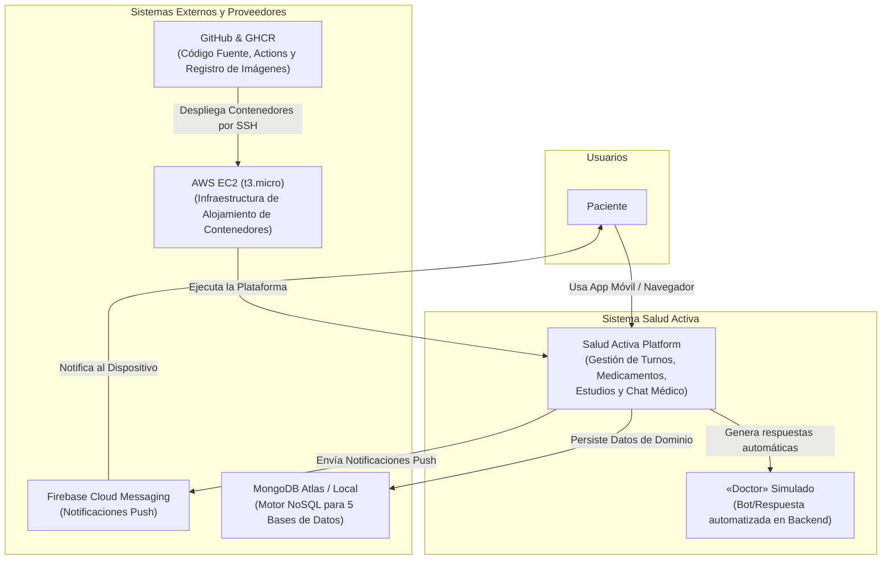
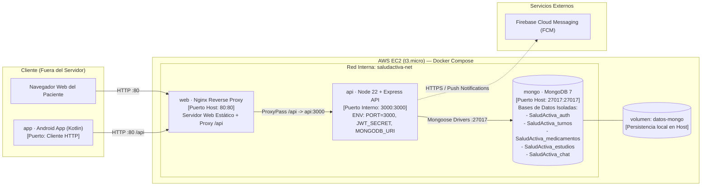
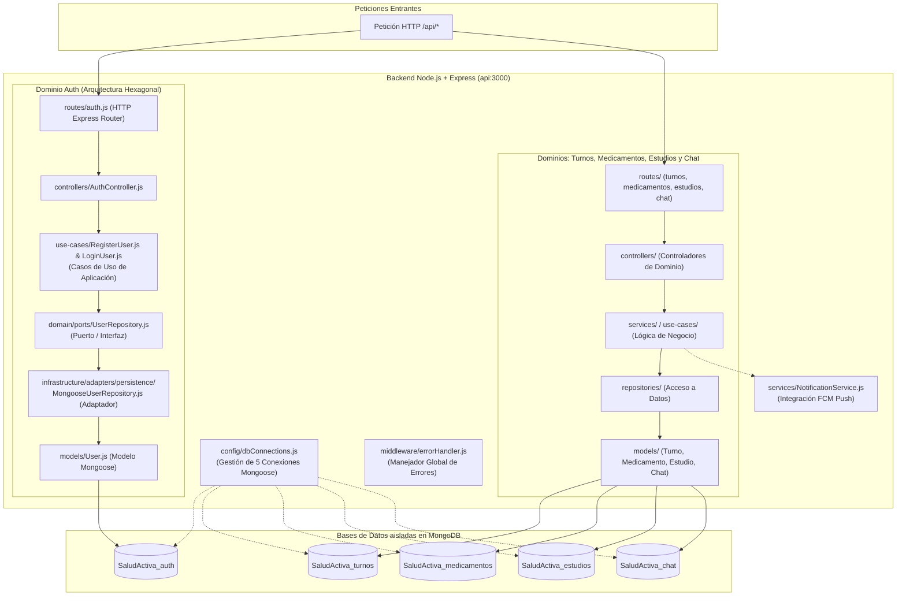

# Documentación de Arquitectura de Software — Salud Activa

Este documento y los diagramas adjuntos representan la arquitectura real y actualizada del sistema **Salud Activa**, corrigiendo discrepancias previas (como referencias obsoletas a AWS Fargate y RDS PostgreSQL). Refleja con precisión la ejecución actual basada en contenedores Docker Compose (`web`, `api`, `mongo`), persistencia aislada en MongoDB 7, arquitectura hexagonal en el backend y despliegue continuo en AWS EC2.

---

## 1. C4 Nivel 1 — Diagrama de Contexto

El diagrama de contexto muestra a los usuarios principales, el sistema Salud Activa y las interacciones con sistemas externos (Firebase Cloud Messaging, GitHub, AWS EC2 y MongoDB Atlas/Local), especificando que la respuesta del doctor en el chat es simulada internamente.



---

## 2. C4 Nivel 2 — Diagrama de Contenedores

Muestra la topología de contenedores en Docker Compose dentro de la instancia AWS EC2, la red interna, los puertos expuestos, las variables de entorno principales y el aislamiento de las 5 bases de datos de dominio en MongoDB.



### Tabla de Contenedores y Configuración de Red

| Contenedor | Imagen / Tecnología | Puerto Expuesto | Red Interna | Variables de Entorno / Volumen |
| :--- | :--- | :--- | :--- | :--- |
| **`web`** | Nginx Alpine + `web/` | `80:80` | `saludactiva-net` | Servidor archivos estáticos web y proxy hacia `http://api:3000`. |
| **`api`** | Node.js 22 + Express | `3000:3000` | `saludactiva-net` | `PORT=3000`, `JWT_SECRET`, `MONGODB_URI`, `AUTH_MONGODB_URI`, etc. |
| **`mongo`** | MongoDB 7.0 | `27017:27017` | `saludactiva-net` | Volumen mapeado: `datos-mongo:/data/db`. Contiene las 5 bases por dominio. |

---

## 3. Diagrama de Componentes del Backend

Describe la estructura interna del backend (`api`), destacando la **Arquitectura Hexagonal** adoptada en el dominio de Autenticación (`auth`) y la estructura por capas utilizada en el resto de los dominios (`turnos`, `medicamentos`, `estudios`, `chat`).



---

## 4. Diagrama de Despliegue (Corte 3)

Muestra cómo se distribuyen los componentes en la infraestructura de producción basada en una instancia **AWS EC2 (t3.micro)** con Docker Compose y conexión desde la aplicación móvil Android y navegadores web.

```mermaid
graph TB
    subgraph Client_Devices["Dispositivos de Usuario"]
        AndroidApp["App Android (Kotlin)\n[Ejecución en Smartphone]"]
        WebBrowser["Navegador Web\n[Ejecución en PC/Móvil]"]
    end

    subgraph AWS_Cloud["AWS Cloud"]
        subgraph EC2_Instance["AWS EC2 Instance (t3.micro)\nIP Pública / DNS de la EC2"]
            subgraph Docker_Engine["Docker Engine + Docker Compose"]
                C_Web["Contenedor: web (Nginx:80)\nServidor de Estáticos y Reverse Proxy"]
                C_API["Contenedor: api (Node.js 22:3000)\nAPI Gateway & Lógica de Negocio"]
                C_Mongo[("Contenedor: mongo (MongoDB 7:27017)\nEngine NoSQL con 5 BDs")]
                Volume_Mongo[("Volumen Docker: datos-mongo\nPersistencia en Disco EFS/EBS")]
            end
        end
    end

    subgraph Registries["Registro de Contenedores"]
        GHCR["GitHub Container Registry (GHCR)\n- ghcr.io/brayanyara1/saludactiva-api\n- ghcr.io/brayanyara1/saludactiva-web"]
    end

    WebBrowser -->|HTTP/80| C_Web
    AndroidApp -->|HTTP/80 /api| C_Web
    C_Web -->|http://api:3000| C_API
    C_API -->|mongodb://mongo:27017| C_Mongo
    C_Mongo --- Volume_Mongo
    GHCR -->|docker compose pull| EC2_Instance
```



---

## 5. Flujo del Pipeline CI/CD

Muestra el pipeline de Integración y Despliegue Continuo (CI/CD) automatizado con GitHub Actions, incluyendo pruebas, escaneo de seguridad con Trivy, publicación en GHCR y despliegue automatizado por SSH a AWS EC2.

> **Nota:** La compilación del APK de Android se mantiene fuera del pipeline de despliegue en servidor.

```mermaid
sequenceDiagram
    autonumber
    actor Dev as Desarrollador
    participant GH as GitHub Repository (main)
    participant GHA as GitHub Actions Runner
    participant Trivy as Trivy Vulnerability Scanner
    participant GHCR as GitHub Container Registry
    participant EC2 as AWS EC2 (t3.micro)

    Dev->>GH: git push origin main
    GH->>GHA: Trigger Workflow (CI/CD Pipeline)

    rect rgb(240, 248, 255)
        Note over GHA: 1. Pruebas Unitarias
        GHA->>GHA: npm test en backend/ (Jest)
    end

    rect rgb(255, 250, 240)
        Note over GHA: 2. Construcción de Imágenes
        GHA->>GHA: docker build -t saludactiva-api ./backend
        GHA->>GHA: docker build -t saludactiva-web ./web
    end

    rect rgb(255, 240, 245)
        Note over GHA,Trivy: 3. Escaneo de Seguridad
        GHA->>Trivy: Escaneo de vulnerabilidades en imágenes
        Trivy-->>GHA: Reporte sin fallos críticos
    end

    rect rgb(240, 255, 240)
        Note over GHA,GHCR: 4. Publicación en GHCR
        GHA->>GHCR: Publish ghcr.io/.../saludactiva-api:latest
        GHA->>GHCR: Publish ghcr.io/.../saludactiva-web:latest
    end

    rect rgb(245, 245, 255)
        Note over GHA,EC2: 5. Despliegue Automatizado por SSH
        GHA->>EC2: Conexión SSH Ejecutar script de despliegue
        EC2->>GHCR: docker compose pull
        EC2->>EC2: docker compose up -d --remove-orphans
    end

    rect rgb(240, 255, 255)
        Note over EC2,GHA: 6. Healthcheck & Verificación
        EC2->>EC2: curl -f http://localhost/api/health
        EC2-->>GHA: HTTP 200 OK (Despliegue Exitoso)
    end
